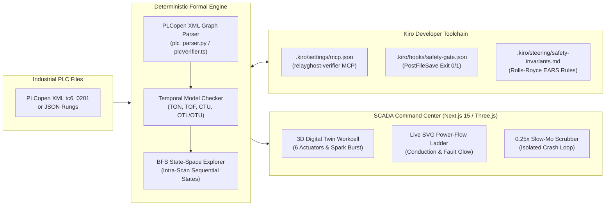

# 🛡️ RelayGhost: Autonomous Industrial SCADA Safety Verifier

> **Bringing Kiro's Spec-Driven Development (EARS) Home to its Industrial Birthplace.**  
> *A Temporal Bounded Model Checker and Digital Twin Verification Engine for 1968 Ladder Logic (IEC 61131-3).*

[](https://opensource.org/licenses/MIT)
[](https://plcopen.org/)
[](https://kiro.dev/)
[](https://modelcontextprotocol.io/)
[](https://nextjs.org/)

---

## 📖 The Rolls-Royce EARS Origin Story

In 2009, **Alistair Mavin** invented **EARS (Easy Approach to Requirements Syntax)** at **Rolls-Royce PLC** specifically to eradicate catastrophic errors in safety-critical jet engines and industrial control systems.

Today, AWS and Kiro have built their entire agentic architecture on EARS. With **RelayGhost**, we bring Kiro's EARS specification engine home to where it was born: protecting the physical factory machinery that powers the real world.

Over 90% of global industrial manufacturing, automotive stamping plants, and automated warehouses run on **1968 Ladder Logic**. Millions of lines of legacy control logic remain undocumented, leaving plants exposed to subtle temporal race conditions that cause catastrophic physical collisions, costing an average of **$22,000 per minute of downtime** (Siemens Industrial Survey).

**RelayGhost** bridges 1960s electrical relay logic with cutting-edge 2026 AI verification.

---

## 🚀 Key Features

* **⚡ Temporal Bounded Model Checker:** Simulates multi-cycle discrete PLC scans with Set/Reset latches (`OTL`/`OTU`), On/Off-Delay timers (`TON`/`TOF`), and Up-Counters (`CTU`).
* **🔍 Breadth-First State-Space Exploration:** Traces temporal execution paths to expose subtle race conditions (e.g., E-Stop resets occurring before a pneumatic venting timer expires).
* **📐 Authentic IEC 61131-3 PLCopen XML (`tc6_0201`) Parser:** Resolves connection graphs between `<leftPowerRail>`, `<contact>`, `<block typeName="TON">`, and `<coil>` into parallel OR-branches with UTF-8 BOM protection.
* **🌐 SCADA Command Center Web Interface:** Built with **Next.js 15, React 19, and Three.js 0.170**, featuring a 3D digital twin workcell, live SVG power-flow diagram, and 0.25x slow-motion auto-looping crash replay.
* **🎯 Universal Actuator & Sensor Normalization:** Maps industrial tags across 6 universal actuators (`%QX0.0`–`%QX0.5`) and 8 sensors (`%IX0.0`–`%IX0.7`).
* **🛡️ Dynamic Deadlock-Free EARS Auto-Synthesizer:** Injects normally closed reciprocal interlocks into secondary conflicting rungs, preventing deadlocks and exporting genuine patched PLCopen XML.
* **🤖 Deep Kiro Developer Toolchain Integration:**
  * **FastMCP Server (`engine/mcp_server.py`):** Exposes `verify_plc_file` and `verify_plc_xml_string` tools over stdio.
  * **Automated Safety Hook (`.kiro/hooks/safety-gate.json`):** Strict Kiro v1 hook running on `PostFileSave`.
  * **Persistent Context Steering (`.kiro/steering/safety-invariants.md`):** Non-negotiable physical safety rules written in EARS.
  * **Spec-Driven Remediation (`.kiro/specs/stamping-press-interlock/`):** 3-Wave execution resolving race conditions.

---

## 🏗️ Architecture



---

## ⚙️ Universal Actuator & Sensor Mapping

To ensure any PLCopen XML file animates seamlessly in a 3D digital twin, RelayGhost maps addresses to 6 standardized physical actuators:

| Universal Address | Physical Actuator / Solenoid | Description |
| :---: | :--- | :--- |
| **`%QX0.0`** | **Hydraulic Stamping Press** | Main vertical forming / stamping cylinder |
| **`%QX0.1`** | **Robotic Transfer Arm** | Horizontal in-die feeder mechanism |
| **`%QX0.2`** | **Infeed Conveyor Belt** | Material transit drive motor |
| **`%QX0.3`** | **Part Clamping Cylinder** | Pneumatic fixture lock |
| **`%QX0.4`** | **Lubricant Valve / Motor** | Hydraulic pump & relief manifold |
| **`%QX0.5`** | **Safety Alarm Beacon** | High-intensity optical/acoustic warning |

---

## 📊 Benchmark Verification Suite (10 Real PLC Programs)

The verification engine was executed across 10 authentic IEC 61131-3 PLCopen XML programs, achieving **100% mathematical parity** between Python and TypeScript:

| Benchmark File Path | Expected Result | Actual Result | Verification Status |
| :--- | :---: | :---: | :---: |
| `plc-benchmarks/known-errors/01_stamping_press_missing_interlock.xml` | **Hazard** | **Hazard (Cycle #4, Fault Rungs: [3, 5])** | ✅ Passed (4-frame replay) |
| `plc-benchmarks/known-errors/err_01_conveyor_gate_bypass.xml` | **Hazard** | **Hazard (Cycle #4, Fault Rungs: [2, 3])** | ✅ Passed (4-frame replay) |
| `plc-benchmarks/known-errors/err_02_dual_motor_reversal_short.xml` | **Hazard** | **Hazard (Cycle #4, Fault Rungs: [2, 3])** | ✅ Passed (4-frame replay) |
| `plc-benchmarks/known-errors/err_03_oven_purge_timer_skip.xml` | **Hazard** | **Hazard (Cycle #4, Fault Rungs: [2, 3])** | ✅ Passed (4-frame replay) |
| `plc-benchmarks/test-for-yourself/02_pneumatic_estop_timer_race.xml` | **Hazard** | **Hazard (Cycle #4, Fault Rungs: [2, 3])** | ✅ Passed (4-frame replay) |
| `plc-benchmarks/test-for-yourself/03_rolls_royce_ears_interlock_baseline.xml` | **Safe** | **Verified Safe (0 Hazards, Full Nominal Run)** | ✅ Passed (7-frame trace) |
| `plc-benchmarks/test-for-yourself/mystery_alpha_robot_handover.xml` | **Hazard** | **Hazard (Cycle #4, Fault Rungs: [2, 3])** | ✅ Passed (4-frame replay) |
| `plc-benchmarks/test-for-yourself/mystery_beta_beremiz_traffic_interlock.xml` | **Safe** | **Verified Safe (0 Hazards, Full Nominal Run)** | ✅ Passed (7-frame trace) |
| `plc-benchmarks/test-for-yourself/mystery_gamma_bottle_filler_latch.xml` | **Hazard** | **Hazard (Cycle #4, Fault Rungs: [2, 3])** | ✅ Passed (4-frame replay) |
| `plc-benchmarks/test-for-yourself/mystery_delta_sequential_motor_startup.xml` | **Safe** | **Verified Safe (0 Hazards, Full Nominal Run)** | ✅ Passed (7-frame trace) |

---

## ⚡ Quick Start

### 1. Run Verification in Terminal
```bash
# Clone the repository
git clone https://github.com/Ashuraj-Herode22/relayghost.git
cd relayghost

# Run the test suite
python3 -m engine.tests.test_temporal_race

# Audit any benchmark file via CLI
python3 engine/verify_cli.py plc-benchmarks/known-errors/01_stamping_press_missing_interlock.xml

# Or test Kiro JSON STDIN piping
echo '{"path": "plc-benchmarks/known-errors/01_stamping_press_missing_interlock.xml"}' | python3 engine/verify_cli.py
```

### 2. Launch the SCADA Command Center Web Interface
```bash
cd web
npm install
npm run dev
```
Open `http://localhost:3000` to interact with the 3D Digital Twin, live SVG ladder viewer, and 0.25x slow-motion crash replay.

### 3. Connect to Kiro IDE
Add the FastMCP server in your Kiro IDE settings (`~/.kiro/settings/mcp.json`):
```json
{
  "mcpServers": {
    "relayghost-verifier": {
      "command": "python3",
      "args": ["engine/mcp_server.py"]
    }
  }
}
```

---

## 🏢 Industrial Applications & Target Sectors

- **Automotive & Metal Stamping:** Hydraulic press line interlocking, robotic transfer clearance, and die damage prevention.
- **Packaging & Material Handling:** High-speed conveyor routing, diverter gate synchronization, and sorting table sequencing.
- **Safety Instrument Systems (SIS):** Continuous formal compliance verification against IEC 61131-3, IEC 61508 (SIL 2/3), and ISO 13849 PLd/e safety lifecycles.
- **Agentic Dev-Tools:** Continuous verification in automated PLC build pipelines via Kiro IDE, FastMCP, and pre-commit agent hooks.

---

## 📄 License

This project is licensed under the **MIT License** — see the [LICENSE](LICENSE) file for details.
